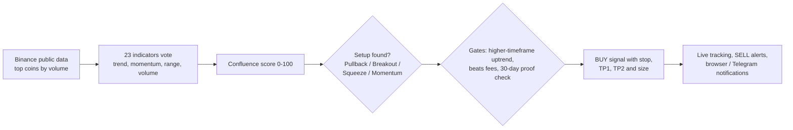

# Spot Trading Toolkit

Two open-source tools for Binance **spot** markets, each with its own local web dashboard:

| Tool | What it does | Needs API keys? | Port |
|---|---|---|---|
| [`signal-predictor/`](signal-predictor) | Scans 20+ coins in real time with 23 indicators and tells you **which coin, when to buy, stop loss, take profit 1 / 2 and when to sell**. Never trades. | No | 8001 |
| [`trading-bot/`](trading-bot) | Automated long-only bot with a hard capital cap, daily loss limit, backtester, paper / testnet / live modes. | Only for testnet / live | 8000 |

> **Risk warning.** Trading cryptocurrency is risky and you can lose all the money you use. Nothing here is
> financial advice or a promise of profit. Most retail bots and signal tools lose money after fees. Backtest, then
> paper trade for weeks, then start small. You are responsible for your own decisions and API keys.
> The software is provided "as is" under the MIT license, with no warranty.

## Quick start

    git clone https://github.com/YOUR_USERNAME/spot-trading-toolkit.git
    cd spot-trading-toolkit
    python -m venv .venv && source .venv/bin/activate     # Windows: .venv\Scripts\activate

**Signals only (no keys, nothing is traded):**

    pip install -r signal-predictor/requirements.txt
    cd signal-predictor && python predictor.py             # http://127.0.0.1:8001

**Trading bot (start in paper mode):**

    pip install -r trading-bot/requirements.txt
    cd trading-bot && cp .env.example .env && python gui.py   # http://127.0.0.1:8000

## How the signal predictor decides

Every signal is tracked to its outcome, and the dashboard shows the tool's real, live win rate and
average R so you can judge it with evidence. Details: [`signal-predictor/README.md`](signal-predictor/README.md).

## Project layout

    signal-predictor/   predictor.py, tests/, requirements.txt, .env.example
    trading-bot/        bot.py (engine + CLI), gui.py (dashboard), tests/, requirements.txt, .env.example
    .github/workflows/  CI: lint + tests on Python 3.11 and 3.12

## Development

    pip install -r signal-predictor/requirements.txt -r trading-bot/requirements.txt -r requirements-dev.txt
    ruff check .
    python -m pytest signal-predictor -q
    python -m pytest trading-bot -q

Tests run fully offline against a fake exchange. See [CONTRIBUTING.md](CONTRIBUTING.md) and [SECURITY.md](SECURITY.md).

## Known limitations
- Long-only spot: neither tool profits from falling markets, so quiet or empty stretches are normal.
- The bot monitors stops itself (polling), rather than placing them as exchange orders, so a crash or lost
  connection leaves positions unprotected until restart. Signal users should place stop / take-profit orders on Binance.
- Backtests use about 30-90 days of data and can overstate how good a strategy is.

## License
[MIT](LICENSE)
